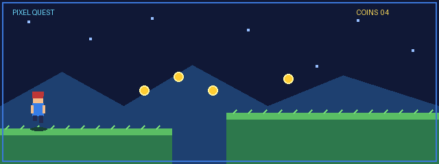

  

  

  

  

  

### Estudante de Desenvolvimento de Sistemas 

  Tenho 17 anos e atualmente curso Desenvolvimento de Sistemas no SENAI e estou no 2º ano do Ensino Médio no SESI.
    
  Sou interessado em tecnologia, programação e inovação. Busco constantemente desenvolver meus conhecimentos técnicos e pessoais, aprimorar minhas habilidades e construir minha trajetória profissional na área de tecnologia.

  

---

## Sobre mim

- Curso Técnico em Desenvolvimento de Sistemas — SENAI.
- 2º ano do Ensino Médio — SESI.
- Interesse em programação e desenvolvimento de software.
- Microsoft Excel — Intermediário.
- Inglês — Avançado.
- Espanhol — Básico.
- Em constante aprendizado e desenvolvimento profissional.

---

## Linguagens e Tecnologias

  
  
  
  
  
  
  
  
  
  
  
  
  

---

## Outros conhecimentos

- Lógica de programação.
- Desenvolvimento de Sistemas.
- Microsoft Excel — Intermediário.

---

## Meu currículo

  Conheça um pouco mais sobre minha formação, conhecimentos, idiomas e habilidades profissionais.

  

---

## Obrigado pela visita!

  <i>
    <strong>
      "O aprendizado contínuo é o caminho para transformar conhecimento em oportunidades."
    </strong>
  </i>

  Obrigado por visitar meu perfil!

